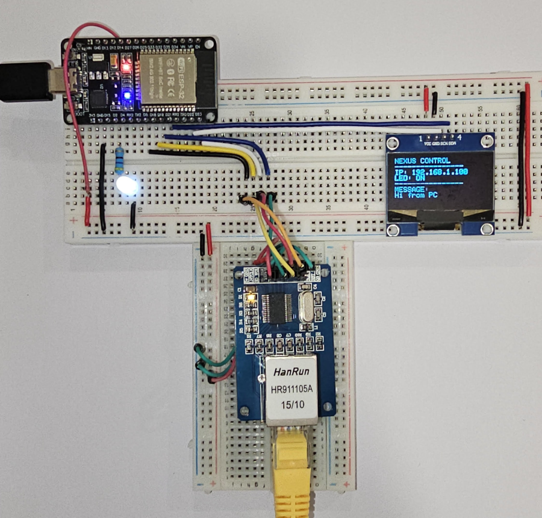
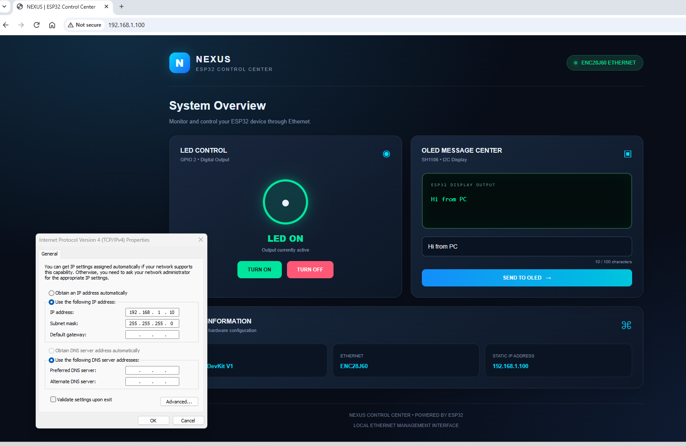

# ESP32 ENC28J60 Ethernet Control Dashboard

A web-based control dashboard built using an **ESP32 DevKit V1** and an **ENC28J60 Ethernet module**. The project provides a browser-based interface to control an LED and send custom messages to an OLED display over a local Ethernet network.

The dashboard features a modern cyber-themed interface called **NEXUS ESP32 Control Center**, designed to provide a simple and interactive way to communicate with the ESP32.





## Features

- **Ethernet Connectivity:** Network communication using the ENC28J60 Ethernet module.
- **Static IP Configuration:** Configurable network settings with a default IP address of `192.168.1.100`.
- **Web-Based Dashboard:** Modern, responsive HTML, CSS, and JavaScript interface.
- **LED Control:** Turn the ESP32 onboard/external LED ON or OFF directly from the dashboard.
- **OLED Message Control:** Send custom text messages from the web interface to the OLED display.
- **Real-Time UI Feedback:** Dashboard updates its LED and message status after successful requests.
- **No Wi-Fi Required:** Communication takes place over wired Ethernet.

## Hardware Requirements

| Component | Description |
|---|---|
| ESP32 DevKit V1 | Main microcontroller |
| ENC28J60 | SPI Ethernet module |
| SH1106 OLED | 128x64 I2C display |
| LED | Status indicator |
| Resistor | Current limiting for external LED |
| Ethernet Cable | Network connection |

## Hardware Connections

### 1. ENC28J60 Ethernet Module

The ENC28J60 communicates with the ESP32 using SPI.

| ENC28J60 Pin | ESP32 GPIO |
|---|---|
| CS | GPIO 5 |
| SCK | GPIO 18 |
| SO / MISO | GPIO 19 |
| SI / MOSI | GPIO 23 |
| VCC | According to module specifications |
| GND | GND |

### 2. SH1106 OLED Display

The OLED communicates with the ESP32 using I2C.

| OLED Pin | ESP32 GPIO |
|---|---|
| SDA | GPIO 21 |
| SCL | GPIO 22 |
| VCC | According to display specifications |
| GND | GND |

Default I2C address: `0x3C`

### 3. LED Connection

| LED Pin | ESP32 GPIO |
|---|---|
| LED Anode (+) | GPIO 2 through a current-limiting resistor |
| LED Cathode (-) | GND |

**Note:** GPIO 2 is a boot-strapping pin on the ESP32. Ensure external circuitry does not interfere with the board's boot process.

## Software Requirements

Install the following libraries through the Arduino IDE Library Manager:

| Library | Purpose |
|---|---|
| EthernetENC | ENC28J60 Ethernet communication |
| Adafruit GFX Library | Graphics library |
| Adafruit SH110X | SH1106 OLED display support |

The following libraries are included with the ESP32 Arduino core:

- SPI
- Wire

## Network Configuration

The project uses a static IP address.

Default configuration:

| Parameter | Value |
|---|---|
| IP Address | `192.168.1.100` |
| Subnet Mask | `255.255.255.0` |
| Gateway | `192.168.1.1` |
| DNS Server | `192.168.1.1` |
| HTTP Port | `80` |

Make sure these settings match your local network and that the selected IP address is not already assigned to another device.

To change the network configuration, update the following section in the Arduino sketch:

```cpp
byte mac[] = {
  0xDE, 0xAD, 0xBE, 0xEF, 0xFE, 0xED
};

IPAddress ip(192, 168, 1, 100);
IPAddress dnsServer(192, 168, 1, 1);
IPAddress gateway(192, 168, 1, 1);
IPAddress subnet(255, 255, 255, 0);
```

**Important:** The DNS variable is named `dnsServer` to avoid naming conflicts with symbols defined by the Ethernet library.

## Installation and Setup

1. Install the ESP32 board package in Arduino IDE.
2. Install the required libraries.
3. Connect the ENC28J60 module to the ESP32 using the SPI pin configuration.
4. Connect the SH1106 OLED display using the I2C pins.
5. Connect the LED to GPIO 2.
6. Open the Arduino sketch.
7. Verify the network configuration.
8. Select the correct ESP32 board and COM port.
9. Compile and upload the sketch.
10. Connect the ENC28J60 module to your local network using an Ethernet cable.

## Accessing the Dashboard

Once the ESP32 has initialized successfully:

1. Open a web browser on a device connected to the same local network.
2. Enter the ESP32 IP address:

```text
http://192.168.1.100
```

3. The NEXUS ESP32 Control Center dashboard should appear.

## Dashboard Functions

### LED Control

The dashboard provides controls to switch the connected LED ON and OFF.

The browser sends an HTTP GET request to the ESP32:

```text
/led?state=1
```

Turns the LED ON.

```text
/led?state=0
```

Turns the LED OFF.

### OLED Message Control

The dashboard includes a text input that allows users to enter a custom message.

When submitted, the browser sends an HTTP POST request:

```text
POST /message
```

The ESP32 receives the message and updates the OLED display.

The message length is limited to 100 characters.

## HTTP Endpoints

| Method | Endpoint | Description |
|---|---|---|
| GET | `/` | Loads the web dashboard |
| GET | `/led?state=1` | Turns LED ON |
| GET | `/led?state=0` | Turns LED OFF |
| POST | `/message` | Updates OLED message |

## Troubleshooting

| Issue | Possible Solution |
|---|---|
| Dashboard is not accessible | Verify the Ethernet cable and network configuration |
| ESP32 is not reachable | Check that the IP address is available and on the correct subnet |
| OLED remains blank | Verify SDA, SCL, power, and I2C address `0x3C` |
| LED does not respond | Check the GPIO 2 connection and LED polarity |
| Ethernet initialization fails | Check SPI wiring and ENC28J60 power requirements |
| Compilation errors | Verify that the required libraries are installed |

## Project Architecture

```text
             Local Network
                   |
              Ethernet Cable
                   |
              ENC28J60
                   |
                SPI Bus
                   |
              ESP32 DevKit
               /       \
            GPIO 2    I2C Bus
              |          |
             LED       SH1106
                         OLED

                   |
                HTTP Server
                   |
             Web Dashboard
             HTML / CSS / JS
```

## Security Considerations

- The project is intended for local network testing and development.
- The HTTP interface does not implement authentication by default.
- Do not expose the ESP32 web server directly to the public internet.
- Use network segmentation or firewall restrictions where appropriate.
- Avoid sending sensitive information through the web interface.
- Consider adding authentication and HTTPS if adapting the project for a production environment.

## Future Improvements

Potential enhancements include:

- Password-protected dashboard access.
- Ethernet connection status monitoring.
- Additional GPIO controls.
- Sensor integration and monitoring.
- Live device telemetry.
- MQTT integration.
- Secure communication and access control.

## License

This project is provided for educational and development purposes. You are welcome to modify and extend it for your own projects.

---

**Built with ESP32 | ENC28J60 | EthernetENC | SH1106 OLED | HTML | CSS | JavaScript**
